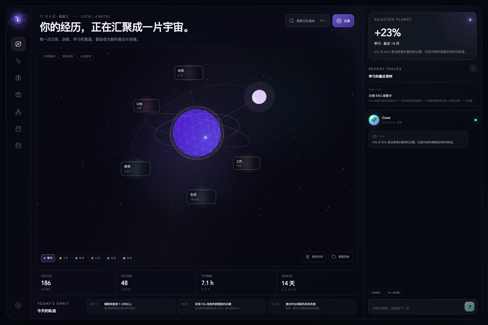
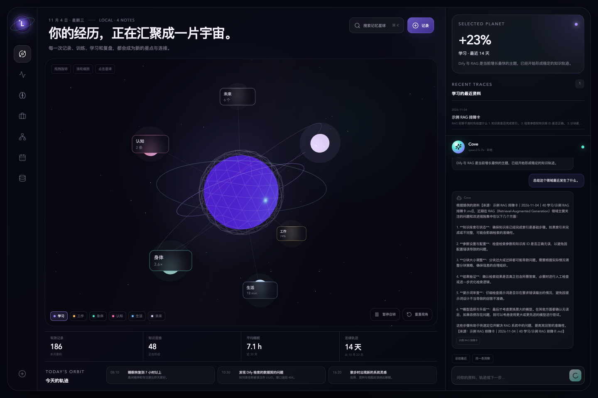
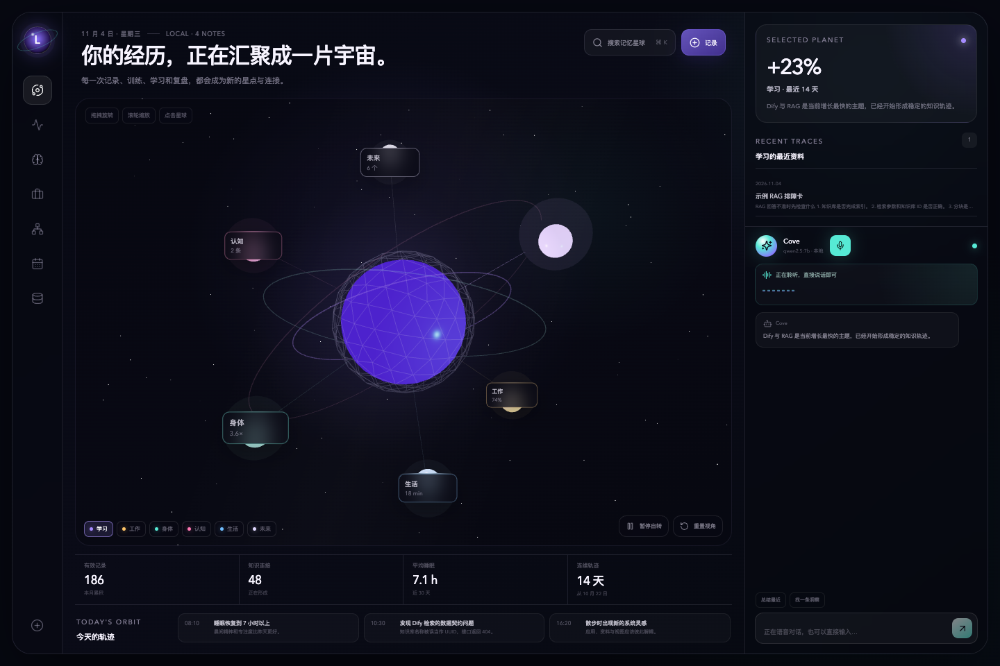
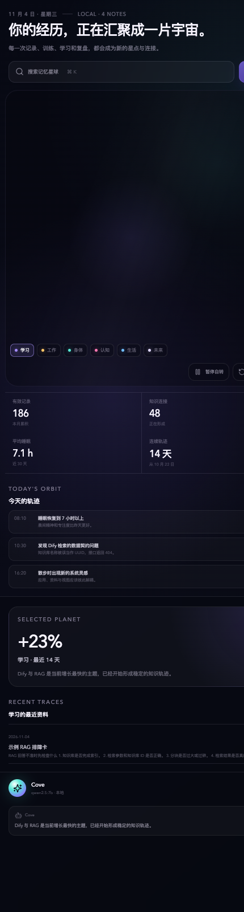
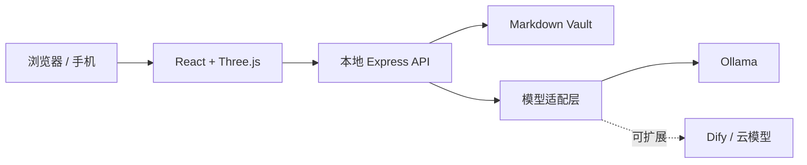

<div align="center">

# LifeOS Local

**把生活、健康、学习、工作和思考，变成一座可探索的三维个人宇宙。**

本地优先 · Markdown 存储 · 3D 成长地图 · 本地语音与 AI 对话


[](https://github.com/okeya24/lifeos-local-showcase/actions/workflows/ci.yml)


[下载 v0.2.0](https://github.com/okeya24/lifeos-local-showcase/releases/tag/v0.2.0) · [产品能力](#-产品能力) · [效果预览](#-效果预览) · [快速启动](#-3-分钟启动) · [路线图](#-路线图) · [隐私边界](#-隐私与数据边界)

</div>



## 为什么做 LifeOS

大多数笔记工具擅长记录，却很难让人看见自己正在怎样变化。

LifeOS Local 尝试回答另一个问题：

> **如果把生活不同领域中的记录放进同一片空间，我能不能看见时间正在如何塑造我？**

它不是一个只有图表的静态 Dashboard，也不是把资料上传到云端的聊天机器人。它把 **本地 Markdown、三维知识空间、长期成长轨迹与本地 AI** 放在一个可运行的系统中。

你拥有文件，而不是拥有一个平台账号。

## 产品能力

| 能力 | 说明 |
| --- | --- |
| **三维人生宇宙** | 拖拽旋转、滚轮缩放、点击星球；学习、工作、身体、认知、生活和未来各自形成可探索的领域 |
| **本地 Markdown** | 每条记录都是可读、可迁移、可 Git 备份的普通文件 |
| **快速记录** | 在应用内直接写入领域、日期和内容，不需要切换编辑器 |
| **本地 AI 对话** | 使用 Ollama，在本机完成模型推理，不依赖云端 API Key |
| **连续语音对话** | 自动检测说话与停顿，流式更新字幕；AI 朗读时可以直接插话打断 |
| **资料来源反馈** | 对话会显示本轮参考的本地笔记标题，减少无依据回答 |
| **多领域成长视图** | 从一块界面查看今日轨迹、长期指标和最近资料 |
| **模型适配层** | 当前支持 Ollama，结构上可以继续接入 Dify 或 OpenAI-compatible API |
| **响应式布局** | 桌面端展示完整宇宙，手机端自动重排内容与镜头 |

## 效果预览

### 三维宇宙与本地 AI 对话



### 连续语音对话



### 手机布局

<p align="center">
  
</p>

## 你可以用它做什么

### 个人成长系统

- 把每日生活、学习和情绪记录放进同一个长期空间。
- 发现“睡眠下降”“运动中断”“学习投入增加”等跨领域关系。
- 每周让 AI 基于真实记录生成复盘，而不是凭空给建议。

### AI 应用工程师成长

- 记录 RAG、Agent、提示词、模型和工程问题。
- 保存踩坑过程与排障卡片。
- 让本地 AI 围绕真实项目历史回答问题并指出来源。
- 积累可以继续导入 Dify 或其他 Agent 平台的知识材料。

### 学习与研究

- 保存知识点、问题和复盘，不必一开始就建立复杂分类。
- 通过领域和关键词筛选最近资料。
- 为后续向量检索、rerank 和长期记忆提供干净的数据基础。

### 生活与健康记录

- 记录睡眠、运动、精力和生活事件。
- 用时间与领域视角观察长期变化。
- 数据默认不离开本机。

> LifeOS 用于个人记录和回顾，不替代医生或专业健康建议。

## 工作流

```text
随手记录
   ↓
Markdown 本地保存
   ↓
领域 / 日期 / 标签整理
   ↓
三维宇宙与成长轨迹可视化
   ↓
本地 AI 检索资料并对话
   ↓
复盘、连接与新的行动
```

## 3 分钟启动

### 环境要求

- Node.js 20+
- pnpm 10+
- [Ollama](https://ollama.com/)

### 安装

```bash
git clone https://github.com/okeya24/lifeos-local-showcase.git
cd lifeos-local-showcase
pnpm install
ollama pull qwen2.5:7b
brew install whisperkit-cli
pnpm voice
```

另开一个终端启动界面和对话服务：

```bash
pnpm dev
```

打开：<http://127.0.0.1:5173>

默认调用本机 `qwen2.5:7b`。也可以使用环境变量切换模型：

```bash
OLLAMA_MODEL=qwen3-vl:4b pnpm dev
```

生产构建：

```bash
pnpm build
pnpm start
```

打开：<http://127.0.0.1:8787>

## 数据格式

```text
vault/
├── 00 收件箱/
├── 10 每日/
├── 20 身体/
├── 30 认知/
├── 40 学习/
├── 50 工作与项目/
└── 70 方向与愿景/
```

一条记录就是一段 Markdown：

```md
---
title: 今天的记录
date: 2026-11-04
domain: learning
tags:
  - rag
  - dify
---

# 今天学到什么

记录事实、问题、洞察和下一步。
```

资料无需数据库即可阅读；删除应用后，文件仍然存在。

## 架构



设计原则：

1. Markdown 是源头数据。
2. 三维视图只是表现层，可以独立替换。
3. 模型通过适配器接入，不绑定单一供应商。
4. 只向模型发送当前问题最相关的少量资料。
5. 需要未来扩展时再引入向量库、rerank 和 Skill。

## 当前状态

这是一个可运行的开发者预览版，已经真实验证：

- 三维场景加载、旋转、缩放和领域切换
- Markdown 快速记录与持久化
- 本地 Ollama 流式对话
- 连续语音识别、自动断句、分句朗读与插话打断
- 基于当前问题筛选最近资料
- 对话来源标题显示
- 桌面和手机响应式布局

它还不是一键安装的正式消费级产品。

## 路线图

| 阶段 | 内容 |
| --- | --- |
| **已经完成** | 3D 宇宙、Markdown、快速记录、Ollama 流式对话、来源提示 |
| **下一步** | `bge-m3` 向量索引、混合检索、rerank、固定问题评测集 |
| **成长能力** | 每日复盘、周报、健康趋势、学习教练、RAG 排障、长期记忆 |
| **产品化** | 一键安装包、首次启动向导、导入 Obsidian / PDF、数据导出 |
| **远程使用** | 局域网访问、账号权限、HTTPS、加密同步 |
| **云端** | 本地/云端模型路由、按领域授权、团队空间 |

## 隐私与数据边界

- 当前运行只监听 `127.0.0.1`。
- 对话默认使用本机 Ollama，不上传资料。
- 仓库不包含任何 API Key。
- `.env`、日志、依赖和构建产物不会进入 Git。
- 若要公开个人记录，必须先清除当前文件与 Git 历史。

## 已知限制

- 目前只支持 Markdown，不支持自动导入 PDF、Pages、Word 或图片 OCR。
- 检索仍是轻量关键词与最近资料组合，不是真正的向量数据库。
- 语音识别目前针对 Apple Silicon + WhisperKit，其他平台的适配还未完成。
- 还没有账号、多设备同步和云端模型路由。
- macOS 用户可以直接运行源码，但还没有正式 DMG 安装包。

## 参与与反馈

如果你希望它变成真正每天使用的产品，欢迎通过 Issue 提出：

- 你最想记录和可视化哪些生活领域？
- 你希望使用哪个本地模型？
- 你需要 Obsidian、Dify、PDF 或 Apple Health 的哪种导入方式？
- 哪些界面和操作会让你愿意长期使用？
